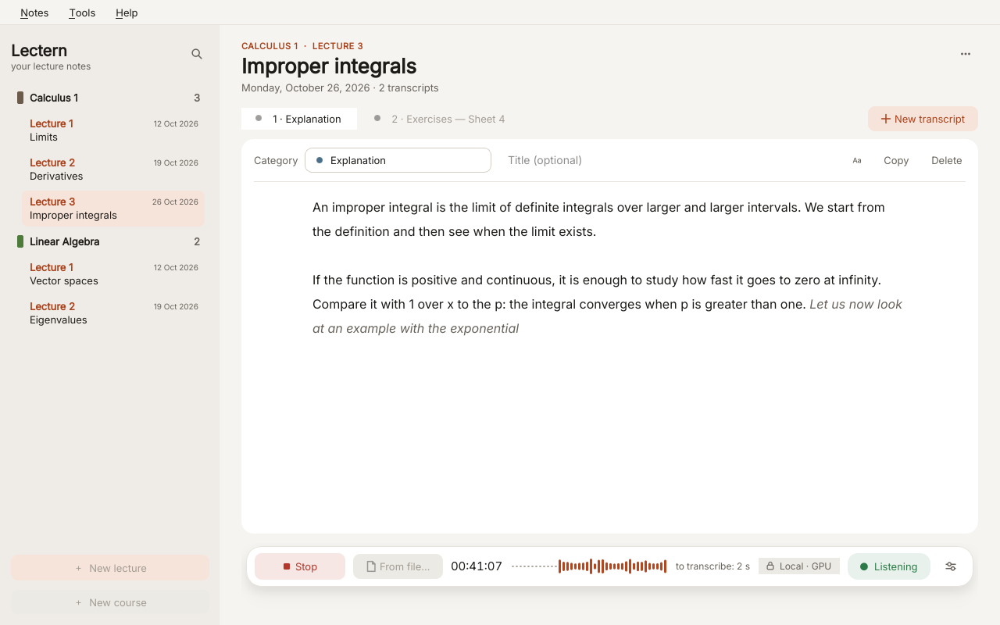

<p align="center">
  <a href="https://github.com/VarCode-ai/monad">
    <picture>
      <source media="(prefers-color-scheme: dark)" srcset="docs/brand/monad-logo-white.svg">
      
    </picture>
  </a>
</p>

<p align="center"></p>

<h1 align="center">Lectern</h1>

<p align="center">
  <b>A lecture notebook that listens: live speech-to-text with Whisper, entirely on your computer.</b>
</p>

<p align="center">
  Lectern records from the microphone and transcribes in real time with
  <a href="https://github.com/openai/whisper">Whisper</a> on
  <a href="https://github.com/openvinotoolkit/openvino.genai">OpenVINO GenAI</a>, on your CPU, Intel GPU or NPU.
  Notes are organized by course, lecture and category, as plain text files you own.<br>
  <i>A <a href="https://github.com/VarCode-ai/monad">Monad</a> app.</i>
</p>

<p align="center">
  <a href="https://github.com/VarCode-ai/lectern/actions/workflows/checks.yml"></a>
  <a href="https://github.com/VarCode-ai/lectern/releases/latest"></a>
  <a href="LICENSE"></a>
  
  <a href="https://github.com/VarCode-ai/monad"></a>
</p>

<p align="center">
  <a href="https://github.com/VarCode-ai/monad"><b>Monad</b></a> ·
  <a href="https://github.com/VarCode-ai/monad#install-in-this-order">Install guide</a> ·
  <a href="https://github.com/VarCode-ai/ovms-manager">OVMS Manager</a> ·
  <a href="https://github.com/VarCode-ai/monad#the-apps">All Monad apps</a>
</p>

<br>

<p align="center">
  
</p>

> [!NOTE]
> **Lectern is part of [Monad](https://github.com/VarCode-ai/monad)**, a family of desktop apps that run AI models locally with
> Intel OpenVINO: no cloud, no accounts, no telemetry. If you are new to Monad, start from the
> [install guide](https://github.com/VarCode-ai/monad#install-in-this-order): it covers the system packages and the recommended
> order, **[OVMS Manager](https://github.com/VarCode-ai/ovms-manager) first, then Lectern**, so that both
> apps share the models in `~/models`.

<p align="center">
  <a href="#install">Install</a> ·
  <a href="#whisper-models">Whisper models</a> ·
  <a href="#using-the-notebook">Using the notebook</a> ·
  <a href="#batch-transcription-lectern-transcribe">lectern-transcribe</a> ·
  <a href="#how-live-transcription-works">How it works</a> ·
  <a href="#privacy">Privacy</a> ·
  <a href="#tips-and-troubleshooting">Troubleshooting</a>
</p>

Lectern also installs **lectern-transcribe**, a command-line tool that transcribes every audio or video
file in a folder.

## Install

### Download the AppImage

From the [latest release](https://github.com/VarCode-ai/lectern/releases/latest), download
`Lectern-<version>-x86_64.AppImage`, then:

```bash
chmod +x Lectern-*-x86_64.AppImage
./Lectern-*-x86_64.AppImage
```

The same AppImage runs **lectern-transcribe**, the batch tool:

```bash
./Lectern-*-x86_64.AppImage transcribe -i ~/Lectures   # --help for every option
```

The AppImage carries its own Python, Qt and OpenVINO: it installs nothing, needs no root and runs on any
x86-64 distribution with glibc 2.34 or newer. To verify it, compare it with `SHA256SUMS` from the same
release. To add it to the application menu, use [Gear Lever](https://flathub.org/apps/it.mijorus.gearlever)
or [AppImageLauncher](https://github.com/TheAssassin/AppImageLauncher), or install from source.

### Download the archive and install it

From the same release, download `Lectern-<version>.tar.gz`, then:

```bash
tar -xzf Lectern-*.tar.gz
cd lectern-*/
./install.sh
```

The installer works as described below. Once the app is installed you can delete the folder.

### Install from source

```bash
git clone https://github.com/VarCode-ai/lectern.git
cd lectern
./install.sh
```

The installer copies the files to `~/.local/share/lectern/app` and creates a Python environment with
OpenVINO GenAI and PySide6 (a few hundred MB). It adds **Lectern** to the application menu and two
commands to `~/.local/bin`: `lectern` and `lectern-transcribe`. Run `./install.sh --help` for every
option, and `./install.sh --uninstall` to remove it. Your notes and models are kept.

While Lectern records or transcribes a file, the computer does not suspend, not even when you close the lid:
a suspend in the middle of a lecture would lose the audio and can hang the GPU. Lectern holds a
`systemd-inhibit` lock only for as long as the work runs. To let the computer suspend as usual, install with
`./install.sh --allow-sleep` (`--keep-awake` turns it back on; an update keeps the previous choice). Outside
the installer, `LECTERN_KEEP_AWAKE=0` does the same, for example for the AppImage.

To try Lectern without installing it, run `./lectern.sh` from the clone. It needs a Python environment
that already has the packages in `requirements.txt`.

Requirements: Python 3.10+ and `ffmpeg`. To use an Intel GPU you also need the Intel compute runtime;
see [System packages](https://github.com/VarCode-ai/monad#system-packages-by-distribution) in the Monad README for the
package names.

The interface is in English or Italian and follows your system language. To change it, use
**Tools → Interface language**, then restart Lectern. The language also sets the names Lectern gives to new
folders and categories (for example *Lecture 03* or *Lezione 03*, *Explanation* or *Spiegazione*).

## Whisper models

Lectern uses Whisper models already converted to OpenVINO, stored in `~/models` (or
`$OPENVINO_MODELS_DIR`). Download them from the *Speech-to-Text* type in
[OVMS Manager](https://github.com/VarCode-ai/ovms-manager), or directly from
[huggingface.co/OpenVINO](https://huggingface.co/OpenVINO):

```bash
~/.local/share/lectern/venv/bin/hf download OpenVINO/whisper-large-v3-turbo-int8-ov \
    --local-dir ~/models/OpenVINO/whisper-large-v3-turbo-int8-ov
```

`lectern-transcribe` downloads `whisper-large-v3-turbo-int8-ov` by itself the first time if no Whisper
model is found.

| Model | Size | Use |
| --- | --- | --- |
| `whisper-large-v3-turbo-int8-ov` | ~0.8 GB | **Live recording.** Fast, with accuracy close to large-v3. |
| `whisper-large-v3-int8-ov` | ~1.6 GB | **Files.** The most accurate on difficult audio, about 4 times slower. |
| `whisper-small-*` / `whisper-base-*` | 0.1–0.3 GB | Slow CPUs without an Intel GPU. Less accurate. |
| `distil-whisper-*` | — | English only. |

Lectern finds every folder under `~/models` whose path contains `whisper` and that holds an
`openvino_encoder_model.xml`. Press **F5** to refresh the list after downloading a model.

## Using the notebook

1. **Create a course** for each subject. You can save it in the default folder or anywhere else, for
   example a synced folder. *Recurring terms* (technical words, proper names) help Whisper spell them
   correctly in every lecture of that course.
2. **Create a lecture** (Ctrl+N). Number and date are suggested automatically.
3. **Record** (Ctrl+R). Grey italic text is the preview of what you are saying. At every pause it
   becomes final text in the normal color and is saved to disk immediately, so a crash loses at most the last
   sentence. You can correct the final text while the recording goes on.
4. **New transcript** (Ctrl+T) splits the lecture by category (Explanation, Exercises, Questions…), even
   during a recording: from that moment the text goes into the new transcript.
5. **From file…** (Ctrl+Shift+R) transcribes audio or video you have already recorded into the open
   lecture, one transcript per file. This mode is slower than live recording but more accurate.
6. **Export** (Ctrl+E) merges the transcripts of a lecture into one Markdown file.

### Where notes are stored

```
~/Documents/Lecture Notes/              # your localized Documents folder
├── .courses.json                       # courses saved in other folders
└── Calculus 1/
    ├── .course.json                    # recurring terms and audio folder of the course
    └── Lecture 03 — 2026-10-01 — Improper integrals/
        ├── 01 — Explanation.txt
        ├── 02 — Exercises — Sheet 4.txt
        └── Recording 10-15-02.wav      # only with "Also save the audio"
```

Everything is plain files: you can rename, move, back up or sync them with any tool. A lecture folder is
recognized by the pattern `<word> <number> — <yyyy-mm-dd>[ — <topic>]`, so folders named in any language
(`Lecture 02 — …`, `Lezione 02 — …`, `Vorlesung 02 — …`) show up.

The notebook folder is called `Lecture Notes` in English and `Appunti delle lezioni` in Italian. If one of
them already exists, Lectern keeps using it whatever the interface language, so switching language never
hides your notes.

### The recorder dock

The bar at the bottom of the lecture holds everything about recording:

- **Record / Stop** and **From file…**;
- the elapsed time;
- a live **waveform** of the microphone, colored where speech is detected, so you can see at a glance that
  Lectern hears the speaker;
- the audio **still to transcribe**;
- a **Local · GPU** chip with the device actually running Whisper (it changes to CPU if Lectern has to fall
  back): the audio never leaves your computer;
- the status, and the recording settings.

### Appearance and reading

- **Tools → Appearance**: theme (*System*, *Light* or *Dark*: *System* follows the desktop, also when it
  switches at sunset) and **Reduce motion**, which keeps the status dot steady.
- The **Aa** button above the transcript sets the reading size (small, medium, large) and the typeface:
  *Sans serif* (Inter) or *Serif* (Newsreader, comfortable for long reading).
- **Ctrl+K** opens the **command palette**: type a few letters to run any menu action, open any lecture of any
  course, or start a new transcript in a category.

### Recording settings

Open them with **Settings** (Ctrl+,).

| Setting | Meaning |
| --- | --- |
| Microphone | Input device. The list updates when you plug devices in. |
| Model | Whisper model. Use a *turbo* model live. |
| Device | `GPU`, `CPU` or `NPU`. If the device cannot be used, Lectern switches to the CPU and tells you. If the GPU fails twice during a lecture, it continues on the CPU without losing audio, and a banner offers to restart Lectern on the GPU: the recording starts again by itself. |
| Language | Language of the lecture. *Auto-detect* works, but a fixed language is more reliable on short sentences. |
| Precision | *Fast* (greedy decoding) is recommended live. *High* (beam search 5) is more accurate but every sentence arrives a few seconds later. |
| Sensitivity, Pause | How loud speech must be, and how long a silence closes a sentence. For a distant speaker use *High* sensitivity and a pause around 1 s. |
| Context | Terms valid for every course, added to the course's recurring terms. |
| Preview while you speak | Turn it off to save power on battery: text appears only at each pause. |
| Time for every sentence | Prefixes each sentence with `[hh:mm:ss]`. |
| Also save the audio | Saves a `.wav` in the lecture folder, or in the course's audio folder if set. You can transcribe it again later with a more accurate model. |

### Keyboard shortcuts

| Keys | Action |
| --- | --- |
| Ctrl+K | Command palette: actions, lectures, new transcripts |
| Ctrl+N | New lecture |
| Ctrl+T | New transcript |
| Ctrl+R | Start / stop recording |
| Ctrl+Shift+R | Transcribe audio files |
| Ctrl+E | Export the lecture to Markdown |
| Ctrl+Shift+C | Copy the transcript text |
| Ctrl+O | Open the folder |
| Ctrl+, | Recording settings |
| F5 | Refresh the model list |
| F1 | Quick guide |

When a new version is released, a banner at the top of the page links to its notes. **Help → Check for
updates** checks right away, and **Help → Check for updates automatically** turns the daily check off.

## Batch transcription: lectern-transcribe

`lectern-transcribe` transcribes every audio or video file in a folder (`mp3`, `wav`, `m4a`, `aac`,
`flac`, `ogg`, `opus`, `wma`, `webm`, `mp4`, `mkv`, `mov`) into `.txt` files in a `transcripts`
subfolder. Files already transcribed are skipped, so an interrupted run resumes where it stopped.

```bash
lectern-transcribe                       # interactive: asks for folder, device, model, language…
lectern-transcribe ~/Lectures GPU        # no questions, default settings
lectern-transcribe ~/Lectures GPU -l it -c strong -t --prompt "Calculus: derivatives, integrals"
```

From the third argument on, the options are passed to `transcribe.py`, which you can also run directly:

```bash
~/.local/share/lectern/venv/bin/python transcribe.py --input ~/Lectures --device CPU --fast
```

| Option | Default | Meaning |
| --- | --- | --- |
| `-i, --input DIR` | current folder | Folder with the files. |
| `-r, --recursive` | off | Include subfolders. The output mirrors the folder structure. |
| `-o, --output DIR` | `<input>/transcripts` | Where to write the `.txt` files. |
| `-d, --device` | `GPU` | `GPU`, `CPU` or `NPU`. Falls back to the CPU if the device cannot be used. |
| `-m, --model` | large-v3, then turbo | A local model folder or a Hugging Face repo id. Missing repos are downloaded to `~/models`. |
| `-l, --language` | `auto` | ISO code (`en`, `it`, `de`…), language name, or `auto`. |
| `-c, --cleanup` | `light` | Audio filters: `none`, `light` (removes hum and hiss, levels the voice), `strong` (also reduces background noise). |
| `-b, --beam N` | `5` | Beam search width. |
| `--fast` | off | Greedy decoding (`--beam 1`), 3–5 times faster. |
| `--prompt TEXT` | none | Subject, terms and names. If the model starts repeating itself, the file is transcribed again without the prompt. |
| `-t, --timestamps` | off | One line per sentence, prefixed with `[hh:mm:ss]`. Without this option, text is split into paragraphs at long pauses. |

## How live transcription works

1. The microphone is recorded as 16 kHz mono through PipeWire's `pw-record` (package `pipewire-utils`
   or `pipewire-bin`) and goes into a buffer. Without `pw-record`, or with `LECTERN_AUDIO=qt`, Lectern
   records through Qt instead; on some laptops Qt 6.12 gets audio in which hardly any speech is detected.
   A watchdog reopens the microphone if it stops sending audio, which can happen with PulseAudio/PipeWire
   after a device suspend.
2. [Silero VAD](https://github.com/snakers4/silero-vad), run with OpenVINO on the CPU, gives the
   probability of speech for every 32 ms frame. If Silero cannot be downloaded on the first start, a
   simpler volume threshold is used instead.
3. A worker thread cuts the audio into sentences at pauses. Segments are kept between 1.5 and 10
   seconds long, because Whisper skips words on longer ones.
4. While you speak, the current segment is transcribed greedily for the preview, with a time budget so
   it never delays the final text. At each pause the segment is transcribed for good and appended to the
   file.
5. Whisper hallucinations are filtered out: loops (the same phrase repeated), phrases it invents on
   silence such as "Thanks for watching", output that just repeats the prompt, and output suspiciously
   short for the amount of speech.

Files (**From file…** and `lectern-transcribe`) use Whisper long-form transcription instead, with
timestamps and ffmpeg audio cleanup. Each 30-second window keeps the previous text as context, which is
more accurate than transcribing short sentences one by one.

## Files

| Path | Content |
| --- | --- |
| `~/Documents/Lecture Notes/` | Your notes (see above). |
| `~/.config/lectern/lectern.conf` | Settings and the last open lecture. |
| `~/.cache/lectern/lectern.log` | Diagnostic log: timings and decisions of each step (**Help → Open log file**). |
| `~/.cache/lectern/silero_vad_openvino_16k.onnx` | Voice detection model, downloaded on first use. |
| `~/.cache/lectern/ov_cache/` | Compiled GPU kernels, which make later starts faster. |
| `~/.local/share/lectern/` | Installed app and Python environment. |

## Tips and troubleshooting

| Problem | Fix |
| --- | --- |
| "to transcribe" keeps growing during a lecture | The model is too slow for this device. Use a *turbo* model, *Fast* precision and the GPU, or turn off the preview. |
| Words are lost when the speaker is far away | *High* sensitivity, pause around 1 s, and add the course terms. Turn on *Also save the audio* and transcribe the `.wav` again later with large-v3. |
| The text repeats the course terms instead of the speech | Lectern detects this and retries without the context. If it keeps happening, shorten the recurring terms. |
| Speech is almost never detected (the waveform moves but is rarely colored) | Install `pw-record` (`pipewire-utils` on Fedora, `pipewire-bin` on Debian/Ubuntu). **Help → Open log file** shows which way the microphone is recorded (`via pw-record` or `via Qt`). |
| *No microphone found* | Check that PipeWire or PulseAudio is running and that the microphone is not muted in your system settings. |
| The GPU is not used | Install the Intel compute runtime (see [System packages](https://github.com/VarCode-ai/monad#system-packages-by-distribution)) and check **Help → Open log file**. |

More fixes are in [docs/troubleshooting.md](docs/troubleshooting.md), and the problems common to every
Monad app in the [Monad troubleshooting guide](https://github.com/VarCode-ai/monad/blob/HEAD/docs/troubleshooting.md).

## Privacy

Lectern transcribes on your computer: your recordings, transcripts and notes never leave it. It connects to
the internet only to download the Whisper model you choose, the Silero voice detection model on the first
recording (1.3 MB; offline it falls back to a volume-based detection), and to check at most once a day for
a new release, which you can turn off in **Help → Check for updates automatically**. The full list of
connections, for every Monad app, is in [Private by design](https://github.com/VarCode-ai/monad#private-by-design).

## Contributing

Bug reports, translations and pull requests are welcome: see [CONTRIBUTING.md](CONTRIBUTING.md).

## License

Copyright © 2026 VarCode-ai. Lectern is free software, released under the
[GNU General Public License v3.0 or later](LICENSE). Third-party components keep their own license:
OpenVINO GenAI (Apache 2.0), Qt for Python / PySide6 (LGPL v3), Silero VAD (MIT), the Whisper models (MIT),
and the Inter and Newsreader fonts (SIL Open Font License 1.1, see `common/fonts/`).

<br>

<p align="center">
  <a href="https://github.com/VarCode-ai/monad"></a><br>
  <sub>Lectern is a <a href="https://github.com/VarCode-ai/monad">Monad</a> app · local AI for OpenVINO</sub>
</p>
